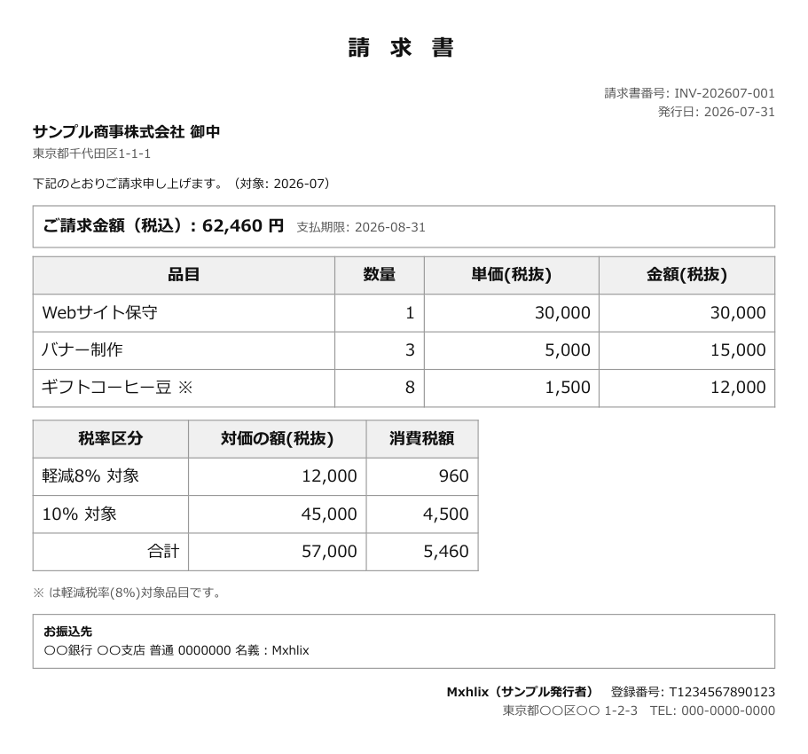

# invoice-gen

[](https://github.com/Mxhlix/invoice-gen/actions/workflows/test.yml)

English | [日本語](#日本語)

A Google Apps Script that turns line items in a Google Sheets spreadsheet into invoice PDFs, one per client.
The invoices carry the fields required for a qualified invoice under Japan's invoice system, and every issued invoice is recorded in a ledger.



The image shows the invoice for client C001 in the demo data. The client, the issuer and the registration number are all fictional.

## What it does

- Groups the rows for the target month in the 「明細」 (line items) sheet by client and billing unit, and saves invoice PDFs to Drive.
- If the billing unit is blank, it makes one monthly invoice. If a billing unit is filled in, it makes one invoice per case.
- Assigns invoice numbers per month in the form `INV-202607-001`, and records the amount and a link to the PDF in the 「発行台帳」 (issue ledger) sheet.
- Anything already in the issue ledger is not issued again, even if you run it again.
- Can issue automatically on a fixed day each month (a time-driven trigger). This can be combined with manual runs.
- Each run records the date and time, the count and success or failure in the 「実行ログ」 (run log) sheet.
- Only when an automatic run fails, it notifies the configured person by email.
- A demo mode lets it run without real data.

## Design notes

- Consumption tax is rounded only once per tax rate. This follows the National Tax Agency's explanation (No.6625, checked on 2026-07-13). It does not round per line and then add up. You can choose rounding down, rounding half up, or rounding up.
- It has no feature for sending invoices to clients. To keep a wrong recipient or amount from reaching anyone outside the company, the PDF is only saved to Drive. The only email it sends is the failure notice, and its recipient is fixed to the person running the script. There is no setting to change the recipient.
- No double issuing. If a client, target month and billing unit combination is already in the issue ledger, it is skipped. This holds even when an automatic run and a manual run fall in the same month.
- Settings live in a sheet. The automatic issue day and target month can be changed in the 「自動発行設定」 (auto-issue settings) sheet without touching code. An unreadable run time or target month falls back to the default. An unreadable issue day skips issuing.
- Text shown in output is escaped. HTML in a client name or item will not act as tags inside the invoice.
- A logging failure does not stop issuing. If writing to the run log fails, invoice issuing continues.

## Verification

GAS does not run locally, so `test/mock-gas.js` imitates GAS features (spreadsheets, Drive, email, triggers and so on), and `src/Code.gs` runs on Node without modification.

Main things checked:

- Automatic issuing runs only on the issue day, and does nothing on other days or when it is turned off. This includes the "end of month" setting and months without a 31st.
- On failure, the failure is recorded in the run log and exactly one email reaches the person who ran it.
- A manual run creates 3 invoices with correct numbers, tax amounts and totals, and a second run issues nothing.
- Consumption tax is rounded once per tax rate. With the demo numbers, per-line rounding gives the same result, so separate numbers that change the result are prepared. This test fails if the calculation is swapped for per-line rounding (confirmed).
- Payment due date settings, and the defaults for blank or invalid values.
- The invoice HTML includes the registration number, the reduced-tax-rate mark and the tax amount per rate, and the client name is escaped.
- Invoice numbers do not collide even past 1,000 invoices in the same month. The original implementation wrapped back to `000` at the 1,000th invoice; that is fixed.
- There is only one place in the code that sends email, and no code for attachments or sending to clients.

Run on 2026-10-04 with Node.js 24.12.0, all 19 checks passed.

The bundled `docs/sample-invoice.pdf` is the HTML produced by `Code.gs`, printed with Chromium. HTML regenerated under the same conditions in the test environment has the same text content (2026-10-04).

## Getting started

The tests use only Node.js built-ins, with no external packages.
Checked locally on Node.js 24.12.0. On GitHub Actions it passes on Node.js 18, 20 and 22.

```
npm test    # run Code.gs in the GAS imitation and check 19 items
```

To run it on GAS, open Extensions > Apps Script in a Google Sheets spreadsheet, add `src/Code.gs` and `src/appsscript.json`, and run the function `generateInvoices`.
It starts in demo mode. It creates fictional clients and line items, then makes 3 invoices.
The demo steps, switching to real data and setting up automatic issuing are in [src/README.md](src/README.md) (Japanese).

## Project layout

```
src/
  Code.gs            main logic (aggregation, tax, invoice HTML, PDF saving, ledger, auto-issue)
  appsscript.json    manifest (time zone and permissions)
  README.md          setup steps for Apps Script
test/
  mock-gas.js        imitation of GAS features
  load-code.js       loads Code.gs with Node's vm
  run-tests.js       the tests
docs/
  sample-invoice.pdf sample invoice output from demo data
  screen.png         page 1 of the PDF above as an image
```

## Not yet verified

- All tests in this repository are results in the GAS imitation. This repository keeps no record of running it on real Apps Script.
- The look of a PDF made with GAS's own conversion (HTML to PDF) may differ from the bundled PDF (printed with Chromium).
- Date formatting in the imitation ignores the time zone. Real GAS formats in `Asia/Tokyo`, so times near the date boundary have not been checked in the imitation.
- The case where the spreadsheet automatically converts the target month column into a date has not been tried. The code selects rows for the target month by matching the string `2026-07`.

## License

MIT. See [LICENSE](LICENSE).

---

## 日本語

Google スプレッドシートの明細から、取引先ごとの請求書PDFを作る Google Apps Script です。
インボイス制度の適格請求書に必要な項目を載せ、発行した請求書は台帳に記録します。


画像は、デモデータの取引先 C001 の請求書です。取引先・発行者・登録番号はすべて架空です。

### できること

- 「明細」シートの対象月の行を、取引先と請求単位ごとにまとめて、請求書PDFを Drive に保存します。
- 請求単位が空欄なら月まとめの請求書、請求単位を書けば案件ごとの請求書になります。
- 請求書番号を `INV-202607-001` の形で月ごとに振り、「発行台帳」に金額とPDFのリンクを記録します。
- 発行台帳にある分は、もう一度実行しても発行しません。
- 毎月決まった日に自動で発行できます（時間で動くトリガー）。手で実行する発行と併用できます。
- 実行のたびに、日時・件数・成否を「実行ログ」シートに残します。
- 自動発行が失敗したときだけ、設定した本人にメールで知らせます。
- 実データが無くても動くデモモードがあります。

### 設計で気をつけたこと

- **消費税は税率ごとに1回だけ丸める。** 国税庁の説明（No.6625、2026-07-13 に確認）に合わせ、行ごとに丸めて足す計算はしていません。端数処理は切り捨て・四捨五入・切り上げから選べます。
- **請求書を取引先へ送る機能を持たない。** 宛先や金額の誤りがそのまま社外に届かないよう、PDFは Drive に保存するだけです。メールを送るのは失敗の通知1か所だけで、宛先は実行した本人に固定しています。設定で宛先を変える欄はありません。
- **二重に発行しない。** 取引先・対象月・請求単位の組が発行台帳にあれば飛ばします。自動発行と手での発行が同じ月に重なっても同じです。
- **設定はシートで変える。** 自動発行の日や対象月は「自動発行設定」シートで変えられ、コードを触る必要はありません。読めない実行時刻や対象月は既定値に戻し、読めない発行日のときは発行を見送ります。
- **画面に出す文字はエスケープする。** 取引先名や品目にHTMLが入っていても、請求書の中でタグとして働きません。
- **ログの失敗で発行を止めない。** 実行ログの書き込みに失敗しても、請求書の発行はそのまま進みます。

### 検証

GAS はローカルでは動かないので、`test/mock-gas.js` で GAS の機能（スプレッドシート・Drive・メール・トリガーなど）を模擬し、`src/Code.gs` を書き換えずに Node の上で実行して確かめています。

主に確かめていること:

- 発行日に当たる日だけ自動発行が動き、当たらない日・OFF の日は何もしないこと。「月末」指定や、31日が無い月の扱いも含みます。
- 失敗したとき、実行ログに失敗が残り、メールが実行者本人宛に1通だけ届くこと。
- 手での発行で3件の請求書ができ、番号・税額・合計が合っていて、2回目は発行しないこと。
- 消費税が税率ごとに1回だけ丸められること。デモの数字では行ごとに丸めても同じ結果になるため、結果が変わる数字を別に用意しています。計算を行ごとの丸めに差し替えると、このテストが落ちることも確かめました。
- 支払期限の指定と、空欄・不正値のときの既定値。
- 請求書HTMLに登録番号・軽減税率の印・税率ごとの税額が入り、取引先名がエスケープされること。
- 同じ月の請求書が1,000件を超えても番号が重複しないこと。もとの実装では1,000件目が `000` に戻っていたので直しました。
- メールを送るコードが1か所だけで、添付や取引先への送付の処理が無いこと。

2026-10-04 に Node.js 24.12.0 で実行し、19項目すべて合格しました。

同梱の `docs/sample-invoice.pdf` は、`Code.gs` が作るHTMLを Chromium で印刷したものです。テストの環境で同じ条件のHTMLを作り直し、文字の内容が一致することを確かめました（2026-10-04）。

### 動かし方

テストは Node.js の標準機能だけで動き、外部のパッケージは使っていません。
手元で確かめたのは Node.js 24.12.0 です。GitHub Actions では Node.js 18・20・22 で通っています。

```
npm test    # GAS を模擬した環境で Code.gs を動かし、19項目を確かめる
```

GAS で動かすときは、Google スプレッドシートの拡張機能 > Apps Script に `src/Code.gs` と `src/appsscript.json` を入れて、関数 `generateInvoices` を実行します。
最初はデモモードになっていて、架空の取引先と明細を作ってから請求書を3件作ります。
デモの手順、実データへの切り替え、自動発行の設定は [src/README.md](src/README.md) にあります。

### フォルダ構成

```
src/
  Code.gs            本体（集計・税計算・請求書HTML・PDF保存・台帳・自動発行）
  appsscript.json    マニフェスト（タイムゾーンと権限）
  README.md          Apps Script への設置手順
test/
  mock-gas.js        GAS の機能の模擬
  load-code.js       Code.gs を Node の vm で読み込む
  run-tests.js       テスト本体
docs/
  sample-invoice.pdf デモデータの請求書の出力例
  screen.png         上の PDF の1ページ目を画像にしたもの
```

### まだ確かめていないこと

- このリポジトリのテストは、すべて GAS を模擬した環境での結果です。本物の Apps Script 上で動かした記録は、このリポジトリには残していません。
- GAS の変換機能（HTML から PDF）で作ったときの見た目は、同梱の PDF（Chromium で印刷）と違う可能性があります。
- 模擬の日付整形はタイムゾーンを見ていません。本物の GAS は `Asia/Tokyo` で整形するため、日をまたぐ時刻の扱いは模擬では確かめられていません。
- スプレッドシートが「対象月」の列を自動で日付に変えた場合の扱いは試していません。コードは文字列 `2026-07` との一致で対象月の行を選びます。

### ライセンス

MIT です。[LICENSE](LICENSE) を見てください。
